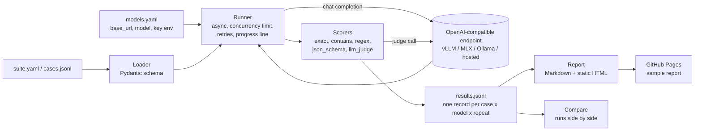

# Grady: Specification (v1)

Grady is a small Python CLI. It runs a suite of prompts against any OpenAI-compatible model
endpoint, scores each answer against what you expected, and produces a report you can read and
share. The name comes from what it does: it grades.

This file is the spec that coding agents build from. Each milestone below is one GitHub issue
and one PR. Changes to this spec land in the same PR as the code that needs them, with a line
in `BUILD_LOG.md` saying why.

---

## 1. Positioning

Larger tools already cover this ground: **promptfoo** (YAML prompt testing and red teaming),
**Inspect AI** (the UK AISI eval framework), **EleutherAI lm-evaluation-harness** (academic
benchmarks), **OpenAI Evals** and **DeepEval** (pytest-style).

Grady is not trying to replace them. It differs in three ways:

- **Small enough to read in one sitting.** The whole package stays under about 1,500 lines.
- **Local-first.** vLLM, MLX, Ollama and LM Studio work out of the box, because they all speak
  the OpenAI chat-completions API.
- **Speed next to quality.** Every result records latency and tokens/sec, so you can compare a
  local model against a hosted one on your own tasks.

---

## 2. Milestones

| # | Milestone | Done when |
|---|---|---|
| M1 | Suite + models loader, async client (timeout, retry, concurrency), `exact` / `contains` / `regex` scorers, progress line, `grady run`, threshold exit code | `grady run examples/basic.yaml` against a local Ollama model prints progress and writes JSONL; CI green |
| M2 | `json_schema` + `llm_judge` scorers, per-case `repeats` | The judge scorer runs against a local model; repeats report a per-case pass rate |
| M3 | `grady report` (Markdown + one static HTML file) and `grady compare` | The HTML report opens offline with no server |
| M4 | `grady judge-check` + hand-labeled set, GitHub Pages sample report, README | CI green, Pages link live, judge-check prints agreement |

Every milestone ships its own tests. CI (ruff, mypy, pytest, secret scan) runs on every PR from
the first commit, and CI never calls a real model.

### Changes from the first draft of the plan

1. **Concurrency, timeout and retry are in M1, not M2.** They belong to the client and runner
   core. An `asyncio.Semaphore` is a few lines now and would otherwise mean rewriting the
   runner. Repeats stay in M2.
2. **CI ships with the scaffold, not in M4.** Every milestone PR shows green checks. M4 keeps
   Pages, judge-check and the README.
3. **Scorers are async from M1.** `exact`, `contains` and `regex` don't need it, but `llm_judge`
   (M2) makes a network call, and one async interface avoids changing every scorer later.

---

## 3. Stack

- **Python 3.11+**, packaged with `uv`, `src/` layout, hatchling build backend.
- **Typer** for the CLI, **httpx** (async) for requests, **Pydantic v2** for the suite schema and
  result records, **PyYAML** for suite files.
- **jsonschema** for the JSON scorer (M2), **Jinja2** for the HTML report (M3): one
  self-contained file, inline CSS, no JS framework.
- **Rich** for the progress line and terminal tables.
- **pytest** with a tiny fake OpenAI-compatible server built on `http.server` (no FastAPI).
  Async tests use the anyio pytest plugin that ships with httpx's dependencies.
- **ruff** (lint + format) and **mypy --strict** on `src/`.
- **pre-commit**: standard hygiene hooks, gitleaks, ruff, mypy, pytest.
- **GitHub Actions**: `ci.yml` (lint, types, tests on 3.11 and 3.12, gitleaks over full history).
  `pages.yml` arrives in M4. It rebuilds the sample report from committed results and publishes
  it to GitHub Pages.

---

## 4. How it works



---

## 5. Suite file

A suite is a YAML file (hand-written) or a JSONL file (bulk or generated).

### YAML

```yaml
suite: json-extraction          # required; name used in output paths and reports
description: Pull fields from short texts as JSON.   # optional
defaults:                       # optional; per-case values override these
  temperature: 0                # default 0.0
  max_tokens: 300               # default 512
  system: "Answer concisely."   # default: no system message
cases:
  - id: invoice-fields-01       # required, unique, [A-Za-z0-9_.-]+
    prompt: |                   # required
      Pull vendor, total and due date from this text as JSON:
      "Acme Supply, invoice 4471, total $1,250.00, due March 3, 2027."
    score:                      # required, at least one entry; all must pass
      - json_schema: schemas/invoice.json        # M2
      - contains: "1250"
  - id: tone-01
    prompt: "Rewrite this as a polite reminder: 'Pay your bill.'"
    temperature: 0.7            # optional override
    score:
      - llm_judge: { rubric: "Polite, one or two sentences, keeps the request clear.", pass_at: 4 }   # M2
```

Unknown keys are errors, not silently ignored. `repeats` (M2) is rejected until M2 adds it.

### JSONL

One case object per line, same fields as a YAML case. The suite name is the file stem
(`cases.jsonl` → `cases`). Defaults are the built-in ones (temperature 0.0, max_tokens 512, no
system message).

### Score entries

Each entry is a **one-key mapping**: the key is the scorer name, the value is its argument.

| Scorer | Argument | Passes when |
|---|---|---|
| `exact` | `"text"` or `{value: "text", ignore_case: true}` | output and value are equal after stripping surrounding whitespace |
| `contains` | `"text"`, a list of strings, or `{value: <either>, ignore_case: true}` | every given string appears in the output |
| `regex` | `"pattern"` | `re.search(pattern, output)` finds a match. Use inline flags such as `(?i)` |
| `json_schema` (M2) | path to a schema file, relative to the suite file | the first JSON object in the output validates |
| `llm_judge` (M2) | `{rubric: "...", pass_at: 1-5, judge: <model label, optional>}` | the judge's 1–5 score is ≥ `pass_at` |

Scorer arguments are validated when the suite loads (for example, a regex that doesn't compile
is a load error naming the case), so a bad suite fails before any request is sent.

### Load errors

Every load error names the file, the case (index and id, or JSONL line number) and the cause:

```
examples/basic.yaml: cases[3] (id 'capital-02'): score[0]: unknown scorer 'containz' (known: contains, exact, regex)
```

---

## 6. Models file

```yaml
models:
  - label: ollama-gemma3-4b          # required, unique, [A-Za-z0-9_.:-]+; used in results
    base_url: http://localhost:11434/v1   # required; Grady POSTs to {base_url}/chat/completions
    model: gemma3:4b                 # required; sent as "model" in the request
    api_key_env: null                # optional; name of the env var that holds the key
    input_price_per_mtok: null       # optional USD per million input tokens (used by compare)
    output_price_per_mtok: null      # optional USD per million output tokens
```

- When `api_key_env` is set and the variable is missing or empty, `grady run` exits with code 2
  before sending anything.
- Keys are sent as `Authorization: Bearer <key>` and are never printed, logged or written to
  results or metadata.

---

## 7. CLI

### `grady run` (M1)

```
grady run SUITE --models MODELS_FILE
          [--model LABEL]...          # repeatable; default: every model in the file
          [--out PATH]                # default: results/<suite>-<YYYYmmdd-HHMMSS>.jsonl
          [--concurrency 4]           # max requests in flight across all models
          [--timeout 60]              # seconds per request
          [--retries 3]               # retries after the first attempt
          [--min-pass-rate 0.0]       # 0.0-1.0; below this, exit 1
          [--warmup | --no-warmup]    # default on: one untimed request per model first
```

**Exit codes**

| Code | Meaning |
|---|---|
| 0 | Run finished, no request errors, pass rate ≥ `--min-pass-rate` |
| 1 | Run finished, pass rate below `--min-pass-rate` |
| 2 | Usage or config error (bad suite, unknown model label, missing API key env var). Nothing was sent |
| 3 | One or more requests still failed after retries. Results are incomplete, so this takes precedence over 1 |

### `grady report`, `grady compare` (M3), `grady judge-check` (M4)

```
grady report RESULTS.jsonl [--out-dir DIR]        # writes report.md and report.html
grady compare RUN_A.jsonl RUN_B.jsonl [...]       # pass rate, median latency, tokens/sec, cost if priced
grady judge-check [judge-check/labeled.jsonl] --models FILE --judge LABEL
```

---

## 8. Runner behavior

- **Warm-up** (default on): before any timed job, Grady sends each selected model one tiny
  request (`"Reply with OK."`, `max_tokens: 1`), one model at a time, so a cold local server
  loads the model before timing starts. Warm-ups are never scored or written to the results
  file. Their latency, attempts and any error go in `.meta.json` and are printed to stderr.
  A failed warm-up is a warning, not a stop: the jobs still run and each records its own
  error, and the exit code follows from the jobs alone. `--no-warmup` skips it, for example
  to measure cold-start latency on purpose.
- Jobs are `cases × selected models × repeats` (repeats is 1 until M2). They run under one
  `asyncio.Semaphore(concurrency)` sharing one `httpx.AsyncClient`.
- **Retries:** on HTTP 408, 429, 500, 502, 503, 504 and on transport errors (connection
  refused, timeouts). Delay is `1s × 2^attempt` plus up to 1s of jitter, capped at 30s. A
  `Retry-After` header in seconds overrides the delay, capped at 60s. Other 4xx responses fail
  at once with the status code and the first 200 characters of the body.
- **Writes:** each record is appended to the JSONL file and flushed as soon as its job
  finishes, so a crash or Ctrl-C keeps everything completed so far.
- **No silent failures:** a job that still fails after retries becomes a record with `error`
  set and `passed: false`. It is counted as an error in the progress line and the summary.
- **Empty or missing content** (`message.content` is null) is scored as an empty string, so
  scorers fail it honestly. A response with no `choices` is a request error.
- **Progress line** (stderr), throttled:
  `[ 37/120 ] 31% | 2.4 cases/s | pass 29 fail 8 | ETA 0:35`. ` err N` is appended when N > 0.
  In a terminal it redraws in place at most 4 times a second. When stderr isn't a terminal
  (CI logs, `| tee`) it prints a plain line at most every 10 seconds, plus one at the end.
- **Summary** (stdout) at the end: one table row per model with cases, pass, fail, err, pass
  rate, median latency and median tokens/sec, then the output path.

### Timing

- `latency_s` is wall-clock time for the final (successful) attempt of the request.
- `tokens_per_s` is `completion_tokens / latency_s`. It is **end-to-end throughput**, prompt
  processing included, not pure decode speed. It is null when the server reports no `usage`.
  Streaming and time-to-first-token are out of scope for v1.
- Both numbers include time a request spends **queued on the server** when `--concurrency`
  exceeds what the server runs in parallel. For answers of a few tokens, `tokens_per_s` says
  little. Reports (M3) must label these as end-to-end figures.
- **Model load time** is kept out of job timings by the warm-up. The first real M1 run, before
  warm-up existed, showed why: gemma3:4b on a cold Ollama measured 4–5 s for the first
  requests against about 1 s warm. With warm-up, the 3.3 s load shows up in `.meta.json`
  instead, and job latencies match a warm run. If a server can't hold every selected model at
  once, a later swap still lands in job latency.

---

## 9. Result files

### `<out>.jsonl`: one record per case × model × repeat

```json
{
  "run_id": "20261114-201502-a1b2c3",
  "suite": "basic",
  "case_id": "capital-01",
  "model": "ollama-gemma3-4b",
  "repeat": 0,
  "prompt": "What is the capital of France? Answer with one word.",
  "output": "Paris",
  "scores": [{"scorer": "exact", "passed": true, "detail": "matched"}],
  "passed": true,
  "latency_s": 0.84,
  "prompt_tokens": 21,
  "completion_tokens": 2,
  "tokens_per_s": 2.38,
  "attempts": 1,
  "error": null,
  "started_at": "2026-11-14T20:15:02.311Z"
}
```

`passed` is true only when there is no error and every scorer passed. Records are written in
completion order. Readers sort by `(model, case_id, repeat)` if they need a stable order.

### `<out>.meta.json`: one per run

Written when the run starts and rewritten with totals when it ends: `grady_version`, `run_id`,
`suite`, `suite_path`, `suite_sha256`, `models` (label, base_url, model; never keys),
`settings` (concurrency, timeout, retries, min_pass_rate, warmup), `git_sha` (of the
working directory, if it is a git repo), `started_at`, `warmup` (one entry per model: label,
latency_s, attempts, error), `finished_at`, and `totals` (jobs, passed, failed, errors,
pass_rate).

---

## 10. Repo layout

```
grady/
├── README.md
├── SPEC.md                 # this file
├── BUILD_LOG.md            # how the agents built it and what review caught
├── pyproject.toml
├── src/grady/
│   ├── cli.py              # run, report, compare, judge-check
│   ├── config.py           # suite + model schemas (Pydantic), loaders
│   ├── client.py           # OpenAI-compatible async client, retries, timing
│   ├── runner.py           # concurrency, repeats, result writing
│   ├── progress.py         # throttled progress line
│   ├── records.py          # result + metadata records
│   ├── scorers/
│   │   ├── base.py
│   │   ├── exact.py  contains.py  regex.py
│   │   ├── json_schema.py  # M2
│   │   └── llm_judge.py    # M2
│   └── report/             # M3
│       ├── markdown.py
│       ├── html.py
│       └── templates/report.html.j2
├── examples/
│   ├── basic.yaml
│   ├── json-extraction.yaml   # M2
│   ├── models.local.yaml      # Ollama / vLLM / MLX / LM Studio / hosted examples
│   └── schemas/               # M2
├── judge-check/
│   └── labeled.jsonl          # M4: ~20 answers graded by hand
├── tests/
│   ├── conftest.py
│   ├── fake_server.py
│   ├── test_config.py
│   ├── test_client.py
│   ├── test_scorers.py
│   ├── test_progress.py
│   ├── test_runner.py         # end-to-end CLI run against the fake server
│   └── test_report.py         # M3
├── sample-results/            # M4: committed run used to build the Pages report
└── .github/workflows/
    ├── ci.yml
    └── pages.yml              # M4
```

---

## 11. Notes for later milestones

- **M2, JSON extraction:** models often wrap JSON in prose or code fences. Extract the first
  JSON object (fenced or bare) before validating, and say in `detail` when none was found.
  Both `json_schema` and the judge's verdict parsing need this, so it lives in one helper.
- **M2, reasoning models:** some local models (Qwen3, DeepSeek-R1 distills) emit
  `<think>…</think>` blocks in `content`. Decide whether the client strips them, and record
  the raw output either way, before adding such a model to the examples.
- **M2, judge settings:** temperature 0, a fixed prompt template, and verdicts returned as JSON
  `{"score": 1-5, "reason": "..."}`. An unparseable verdict is a scorer failure with the raw
  text in `detail`, never a silent pass.
- **M4, judge-check:** the ~20 labels are graded by hand **before** the judge scorer is tuned.
  Report raw agreement and Cohen's kappa.

---

## 12. Out of scope for v1

- A web UI, server or database. Results are files.
- Accounts, multi-user, hosted service.
- Academic benchmark suites (lm-eval-harness territory).
- Red teaming and jailbreak packs (promptfoo's lane).
- Agent or multi-turn tool-use evals.
- Non-OpenAI-compatible APIs (Anthropic native, Gemini native). Use a compatible gateway.
- Streaming and time-to-first-token.
- Cost tracking beyond the optional price-per-million-tokens fields.
- All examples are generic. No real people, organizations or private data.

## 13. After v1, if wanted

- `pass@k` and consistency scoring across repeats.
- A `semantic_similarity` scorer using a local embedding model.
- Run-to-run diff: "these 6 cases flipped from pass to fail."
- A GitHub Action wrapper so other repos can gate PRs on a suite.
- Case generator: a model drafts cases from a short description, then a human edits them.
- Publish to PyPI.
